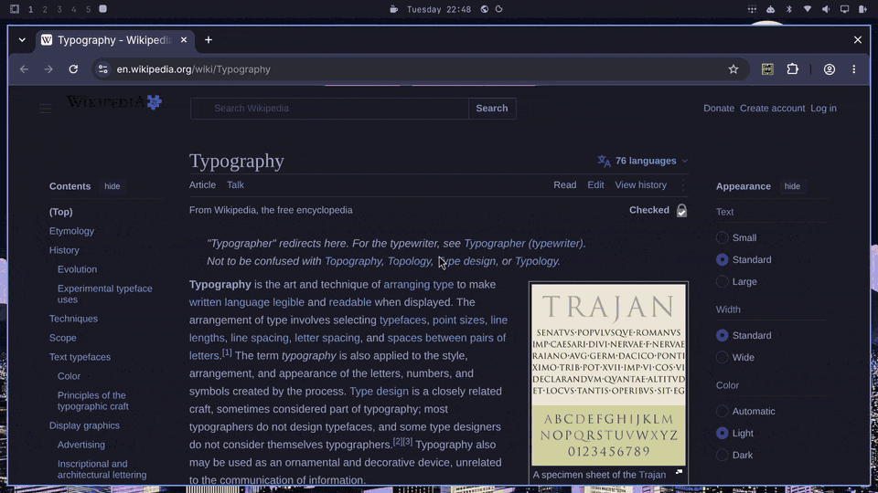

<p align="center">
  <picture>
    <source media="(prefers-color-scheme: dark)" srcset="mockups/icon-dark.png">
    
  </picture>
  &nbsp;
  <picture>
    <source media="(prefers-color-scheme: dark)" srcset="docs/banner-dark.png">
    
  </picture>
</p>

<p align="center"><sub>Omarchy themes for the web</sub></p>

<p align="center">
  <a href="https://github.com/badenpiland/omareader/releases"></a>
  <a href="LICENSE"></a>
  <a href="https://omarchy.org"></a>
</p>

## Install

```bash
curl -fsSL https://raw.githubusercontent.com/badenpiland/omareader/main/install.sh | bash
```



<picture>
  <source media="(prefers-color-scheme: dark)" srcset="docs/divider-dark.png">
  
</picture>

## What it does

Omareader is a Chromium extension. A small Python program watches `~/.local/state/omarchy/current` and sends over the background, foreground, and selection color whenever `omarchy theme set` swaps that directory.

The themeing is [Dark Reader](https://darkreader.org/)’s dynamic theme engine (`darkreader` 4.9.133, MIT, copyright Dark Reader Ltd). You do not install the Dark Reader extension. The popup asks once, and only when the Dark Reader extension is installed and enabled. Turning it off asks for permission to manage extensions. Leaving it on means both extensions restyle the page. Pages also get Dark Reader’s site fixes, including Amazon. The bundled list is from Dark Reader 4.9.133. Once a day Omareader downloads that same list from raw.githubusercontent.com, pinned to commit `92637d8c3fbb210853c005e3f25dbbec46dd21fc`. No browsing data is sent. Uncheck “Fetch site fixes daily” in Details to keep the list already in use. A failed download, or a list with a command this version does not know, also keeps the list already in use. Once a day Omareader checks this repo's GitHub releases, including pre-releases. The popup shows the installed version. When a release is newer, it links “Update to” that version. When the check finds nothing newer, it says this version is up to date. Before that check finishes, and when the check fails, it shows the installed version and does not say up to date. That check sends no browsing data.

The toolbar shows the dark glasses while Omareader is on, and the light glasses while it is off. Pause on this site leaves that host alone and shows the light glasses on its tabs.

Link and syntax colors stay on Dark Reader’s usual path. They are not replaced with the terminal’s red, green, and blue. Text that would disappear into the theme background is drawn in the theme foreground. A stylesheet from another host is fetched by the extension and themed the same way. On a dark theme the Amazon header wordmark stays the light sprite Amazon ships, and the orange smile stays orange.

<picture>
  <source media="(prefers-color-scheme: dark)" srcset="docs/divider-dark.png">
  
</picture>

## Shortcuts

Alt+Shift+O turns Omareader on or off. The toolbar badge shows ON or OFF for a moment.

Alt+Shift+U pauses the current site, or themes it again. That is the same switch as pause on this site in the popup. That tab's toolbar icon switches to the light glasses while the site is paused, and back to the dark glasses when the theme returns. This shortcut does not flash a badge.

Change either shortcut at `chrome://extensions/shortcuts`.

Both are `chrome.commands` suggested keys, using Alt+Shift and a letter. Omarchy's Hyprland defaults bind letter keys with SUPER. That is `default/hypr/bindings.conf` and `default/hypr/bindings/*.conf` in [basecamp/omarchy](https://github.com/basecamp/omarchy), and the current `default/hypr/bindings/*.lua` in [omacom/omarchy](https://github.com/omacom/omarchy). Obsidian is SUPER+O and SUPER+SHIFT+O. Pseudo window is SUPER+P, and Google Photos is SUPER+SHIFT+P. The chords that leave SUPER out are Ctrl+Alt+Delete, Alt+Tab, Alt+Shift+Tab, Ctrl+Alt+Tab, Ctrl+Alt+Shift+Tab, Print, Alt+Print, the media keys, F9, and Right Alt held for dictation. The older tiling config also binds Alt+F11 and Shift+F11. A Japanese layout binds Ctrl+Shift+semicolon for zoom, and a terminal receives Ctrl+Space without consuming it. Chrome refuses a Ctrl+Alt suggested key, because that pair is AltGr. Chromium already uses Ctrl+P to print, Ctrl+Shift+O for the bookmark manager, and Alt+Shift+T to focus the toolbar. Alt+Shift+U is outside that set.

<picture>
  <source media="(prefers-color-scheme: dark)" srcset="docs/divider-dark.png">
  
</picture>

## Install details

Chromium, Chrome, Brave, Brave Origin, and Edge. Firefox and Zen are not supported yet.

**Curl installer (current).** [v0.3.1](https://github.com/badenpiland/omareader/releases/tag/v0.3.1). The one-line command is in [Install](#install) above.

The command follows the Omarchy default browser and installs Omareader only there. Chromium, Brave, Brave Origin, and Edge load it on the next restart. Chrome asks once for sudo and writes the extension where Chrome will load it. Restart that browser.

If a browser already refused the extension, it will not accept the installer again until the extension is installed by hand once, removed, and the command is run again.

The palette has to come from your machine, so the extension and the native host are installed together. The extension id is `mhglniaepbokfgnpeennihlifandcgjh`.

The command fetches this installer from `main`. The installer then downloads the native host and the signed extension from the latest GitHub release, [v0.3.1](https://github.com/badenpiland/omareader/releases/tag/v0.3.1). It checks the published checksum and stops if that file is missing. It does not compile anything and it does not create a signing key. From a checkout, `./install.sh` installs the host in that checkout and, when `release/omareader.crx` is already there, that extension.

**Omarchy package (coming soon).** Pending [omarchy-pkgs#1120](https://github.com/omacom/omarchy-pkgs/pull/1120). Once merged:

```bash
sudo pacman -S omareader-bin
```

If you used the curl installer before, run `omareader-cleanup-legacy` after installing the package, then restart your browser. It moves old files to `~/omareader-old`. It does not delete them.

<picture>
  <source media="(prefers-color-scheme: dark)" srcset="docs/divider-dark.png">
  
</picture>

## Permissions & network

The content script matches `<all_urls>`, in every frame, including `about:blank`, with an origin fallback. That is how the theme reaches the page and the frames inside it. The `<all_urls>` host permission is how the extension reads a stylesheet the page linked from another host.

The Dark Reader stylesheet proxy runs in the page's main world from `page-proxy.js`. It is a content script, not an inline script, so a page that allows only `script-src 'self'` does not block it.

Two requests go out once a day. These fetches send no cookies and no page data.

- Dark Reader's site-fix list, pinned to commit `92637d8c3fbb210853c005e3f25dbbec46dd21fc`: `https://raw.githubusercontent.com/darkreader/darkreader/92637d8c3fbb210853c005e3f25dbbec46dd21fc/src/config/dynamic-theme-fixes.config`
- This repo's GitHub releases: `https://api.github.com/repos/badenpiland/omareader/releases?per_page=20`

Uncheck "Fetch site fixes daily" in Details to stop the Dark Reader download. The release check runs once a day.

<picture>
  <source media="(prefers-color-scheme: dark)" srcset="docs/divider-dark.png">
  
</picture>

## Limits

`chrome://` pages and the Chrome Web Store cannot be themed.

<picture>
  <source media="(prefers-color-scheme: dark)" srcset="docs/divider-dark.png">
  
</picture>

## Build from source

```bash
npm ci
npm run build
# then load dist/ as an unpacked extension (chrome://extensions, Developer mode, Load unpacked)
```

The extension id stays `mhglniaepbokfgnpeennihlifandcgjh`, so the native host still works. `scripts/pack.sh` writes `release/omareader.crx` and `release/omareader.crx.sha256`. Upload both files to the GitHub release. `install.sh` checks that checksum and refuses to install when the `.sha256` file is missing. After the release is published, update the Omarchy suggestion at https://github.com/omacom/omarchy/discussions/14632: comment with the version, the install command, and any behavior change that matters for inclusion, and correct the original post if a claim there is no longer true.

```bash
npm run lint
npm test
```

GitHub Actions runs the lint, the tests, and the build on every push and pull request. It does not sign a release.

The public key in `src/manifest.json` pins the extension id. `key.pem` stays private and is how `scripts/pack.sh` signs `release/omareader.crx`. Do not generate a replacement key. A new key would publish a different extension id, and already-installed browsers would keep the old one.

The build refreshes `LICENSES/darkreader-MIT.txt` from `node_modules/darkreader/LICENSE` and copies it into the extension.

<picture>
  <source media="(prefers-color-scheme: dark)" srcset="docs/divider-dark.png">
  
</picture>

## Roadmap

A Firefox version is planned.

The official Omarchy package is [omarchy-pkgs#1120](https://github.com/omacom/omarchy-pkgs/pull/1120).

<picture>
  <source media="(prefers-color-scheme: dark)" srcset="docs/divider-dark.png">
  
</picture>

## Omarchy

The latest release is [v0.3.1](https://github.com/badenpiland/omareader/releases/tag/v0.3.1). v0.2.1 does not start. Inclusion in Omarchy is suggested here: https://github.com/omacom/omarchy/discussions/14632

<picture>
  <source media="(prefers-color-scheme: dark)" srcset="docs/divider-dark.png">
  
</picture>

## License

MIT, see [LICENSE](LICENSE).

Bundles the Dark Reader engine (MIT, Copyright (c) Dark Reader Ltd.), see [LICENSES/darkreader-MIT.txt](LICENSES/darkreader-MIT.txt).
Icon derived from the Omarchy mark (MIT, Copyright (c) David Heinemeier Hansson), see [LICENSES/omarchy-MIT.txt](LICENSES/omarchy-MIT.txt).

The popup wordmark is set in Omarchy Font (MIT, Copyright (c) 2026 Mark Cuda), a fan tracing of the Omarchy wordmark. See [LICENSES/omarchy-font-MIT.txt](LICENSES/omarchy-font-MIT.txt).

Not affiliated with or endorsed by Dark Reader Ltd. or the Omarchy project.
