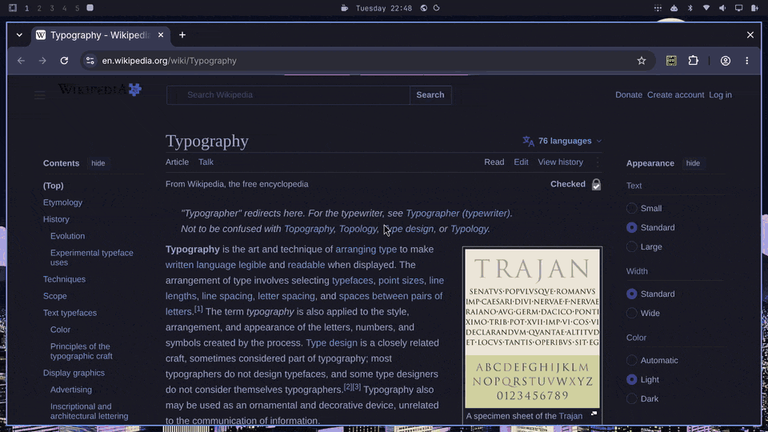

<p align="center">
  <picture>
    <source media="(prefers-color-scheme: dark)" srcset="mockups/icon-dark.png">
    
  </picture>
  &nbsp;
  <picture>
    <source media="(prefers-color-scheme: dark)" srcset="docs/banner-dark.png">
    
  </picture>
</p>

<p align="center"><sub>Omarchy themes for the web</sub></p>

<p align="center">
  <a href="https://github.com/badenpiland/omareader/releases"></a>
  <a href="LICENSE"></a>
  <a href="https://omarchy.org"></a>
</p>

## Install

```bash
curl -fsSL https://raw.githubusercontent.com/badenpiland/omareader/main/install.sh | bash
```



<picture>
  <source media="(prefers-color-scheme: dark)" srcset="docs/divider-dark.png">
  
</picture>

## What it does

Omareader is a Chromium extension that repaints web pages in your current Omarchy theme, and follows along when you switch themes.

- **Theme sync.** A small Python program watches `~/.local/state/omarchy/current` and sends the theme's background, foreground, selection and named colors whenever `omarchy theme set` swaps it, along with the monospace font Omarchy set.
- **Theme colors.** Pages are themed by [Dark Reader](https://darkreader.org/)'s dynamic engine (`darkreader` 4.9.133, MIT, bundled, so you don't need the Dark Reader extension). Omareader then moves every color the page draws as a color to the closest of the theme's own red, orange, yellow, green, cyan, blue and magenta. It keeps the lightness Dark Reader chose, so text stays readable. Grays stay on the theme background and foreground.
- **Readable text.** Text that would disappear into the theme background is drawn in the theme foreground. A stylesheet from another host is fetched by the extension and themed the same way. Dark Reader's site fixes are included, Amazon among them.
- **Popup.** Two switches: "everywhere", and the site you're on by its short name, such as "github" or "google docs". A switch sits right while that one is themed, and shows the shortcut Chromium has bound to it on hover. The popup wears the current theme and the monospace font Omarchy set (`omarchy-font-set` updates it without a browser restart). The bottom row has the site-fix toggle and the version, which shows "v0.4.2 ✓" when up to date and the newer version with a link when a release is out.
- **Toolbar.** The dark glasses show while a tab is themed, and the light glasses while it is disabled.

If the Dark Reader extension is also installed and enabled, the popup asks once whether to turn it off, since both would restyle the page. Turning it off asks for permission to manage extensions.

<picture>
  <source media="(prefers-color-scheme: dark)" srcset="docs/divider-dark.png">
  
</picture>

## Shortcuts

**Changed in 0.4.0:** the two shortcuts swapped places, so each letter says what it covers. U is for universal, every site at once. O is for one site, the one you're on. If you set your own keys, they stay as they are.

Alt+Shift+U (U for universal) disables or enables Omareader everywhere. The toolbar badge shows ON or OFF for a moment.

Alt+Shift+O (O for one site) disables the current site, or enables it again. That is the same switch as the site's switch in the popup, such as "github". That tab's toolbar icon switches to the light glasses while the site is disabled, and back to the dark glasses when the theme returns. The badge also shows ON or OFF for a moment, for this site.

Change either shortcut at `chrome://extensions/shortcuts`.

Both are `chrome.commands` suggested keys, using Alt+Shift and a letter. Omarchy's Hyprland defaults bind letter keys with SUPER. That is `default/hypr/bindings.conf` and `default/hypr/bindings/*.conf` in [basecamp/omarchy](https://github.com/basecamp/omarchy), and the current `default/hypr/bindings/*.lua` in [omacom/omarchy](https://github.com/omacom/omarchy). Obsidian is SUPER+O and SUPER+SHIFT+O. Pseudo window is SUPER+P, and Google Photos is SUPER+SHIFT+P. The chords that leave SUPER out are Ctrl+Alt+Delete, Alt+Tab, Alt+Shift+Tab, Ctrl+Alt+Tab, Ctrl+Alt+Shift+Tab, Print, Alt+Print, the media keys, F9, and Right Alt held for dictation. The older tiling config also binds Alt+F11 and Shift+F11. A Japanese layout binds Ctrl+Shift+semicolon for zoom, and a terminal receives Ctrl+Space without consuming it. Chrome refuses a Ctrl+Alt suggested key, because that pair is AltGr. Chromium already uses Ctrl+P to print, Ctrl+Shift+O for the bookmark manager, and Alt+Shift+T to focus the toolbar. Alt+Shift+U and Alt+Shift+O are outside that set.

<picture>
  <source media="(prefers-color-scheme: dark)" srcset="docs/divider-dark.png">
  
</picture>

## Install details

Chromium, Chrome, Brave, Brave Origin, and Edge. Firefox and Zen are coming in a future version.

**Curl installer (current).** [v0.4.2](https://github.com/badenpiland/omareader/releases/tag/v0.4.2). The one-line command is in [Install](#install) above.

The command follows the Omarchy default browser and installs Omareader only there. If the default is a browser picker, such as brave-pick from omapicker, it installs into the browser the picker starts. Separate instances of that browser that already have Omareader, such as a picker's Personal and Work, are updated too. To choose the browser yourself, name it: `curl -fsSL https://raw.githubusercontent.com/badenpiland/omareader/main/install.sh | OMAREADER_BROWSER=brave-origin bash` (chromium, chrome, brave, brave-origin or edge). Chromium, Brave, Brave Origin, and Edge load it on the next restart. Chrome asks once for sudo and writes the extension where Chrome will load it. Restart that browser.

If a browser already refused the extension, it will not accept the installer again until the extension is installed by hand once, removed, and the command is run again.

The palette has to come from your machine, so the extension and the native host are installed together. The extension id is `mhglniaepbokfgnpeennihlifandcgjh`.

The command fetches this installer from `main`. The installer then downloads the native host and the signed extension from the latest GitHub release, [v0.4.2](https://github.com/badenpiland/omareader/releases/tag/v0.4.2). It checks the published checksum and stops if that file is missing. It does not compile anything and it does not create a signing key. From a checkout, `./install.sh` installs the host in that checkout and, when `release/omareader.crx` is already there, that extension.

**Omarchy package (coming soon).** Pending [omarchy-pkgs#1120](https://github.com/omacom/omarchy-pkgs/pull/1120). Once merged:

```bash
sudo pacman -S omareader-bin
```

If you used the curl installer before, run `omareader-cleanup-legacy` after installing the package, then restart your browser. It moves old files to `~/omareader-old`. It does not delete them.

<picture>
  <source media="(prefers-color-scheme: dark)" srcset="docs/divider-dark.png">
  
</picture>

## Permissions & network

The content script matches `<all_urls>`, in every frame, including `about:blank`, with an origin fallback. That is how the theme reaches the page and the frames inside it. The `<all_urls>` host permission is how the extension reads a stylesheet the page linked from another host.

The Dark Reader stylesheet proxy runs in the page's main world from `page-proxy.js`. It is a content script, not an inline script, so a page that allows only `script-src 'self'` does not block it.

Two requests go out once a day. These fetches send no cookies and no page data.

- Dark Reader's site-fix list, pinned to commit `92637d8c3fbb210853c005e3f25dbbec46dd21fc`: `https://raw.githubusercontent.com/darkreader/darkreader/92637d8c3fbb210853c005e3f25dbbec46dd21fc/src/config/dynamic-theme-fixes.config`
- This repo's GitHub releases: `https://api.github.com/repos/badenpiland/omareader/releases?per_page=20`

Uncheck "fetch site fixes daily" in the popup to stop the Dark Reader download. The bundled list and the downloaded one are both cleaned of remote `url()`, `image-set()` and `@import`, so a site fix can't make a page load files from another host. The release check runs once a day.

<picture>
  <source media="(prefers-color-scheme: dark)" srcset="docs/divider-dark.png">
  
</picture>

## Limits

`chrome://` pages and the Chrome Web Store cannot be themed.

<picture>
  <source media="(prefers-color-scheme: dark)" srcset="docs/divider-dark.png">
  
</picture>

## Build from source

```bash
npm ci
npm run build
# then load dist/ as an unpacked extension (chrome://extensions, Developer mode, Load unpacked)
```

The extension id stays `mhglniaepbokfgnpeennihlifandcgjh`, so the native host still works. `scripts/pack.sh` writes `release/omareader.crx` and `release/omareader.crx.sha256`. Upload both files to the GitHub release. `install.sh` checks that checksum and refuses to install when the `.sha256` file is missing. After the release is published, update the Omarchy suggestion at https://github.com/omacom/omarchy/discussions/14632: comment with the version, the install command, and any behavior change that matters for inclusion, and correct the original post if a claim there is no longer true.

```bash
npm run lint
npm test
```

GitHub Actions runs the lint, the tests, and the build on every push and pull request. It does not sign a release.

The public key in `src/manifest.json` pins the extension id. `key.pem` stays private and is how `scripts/pack.sh` signs `release/omareader.crx`. Do not generate a replacement key. A new key would publish a different extension id, and already-installed browsers would keep the old one.

The build refreshes `LICENSES/darkreader-MIT.txt` from `node_modules/darkreader/LICENSE` and copies it into the extension.

<picture>
  <source media="(prefers-color-scheme: dark)" srcset="docs/divider-dark.png">
  
</picture>

## Roadmap

Coming in a future version:

- Firefox and Zen support.
- An official Omarchy plugin tied to Omareader.

The Omarchy package is pending in [omarchy-pkgs#1120](https://github.com/omacom/omarchy-pkgs/pull/1120), and inclusion in Omarchy is suggested in [omarchy discussion 14632](https://github.com/omacom/omarchy/discussions/14632). v0.2.1 does not start, so update past it.

<picture>
  <source media="(prefers-color-scheme: dark)" srcset="docs/divider-dark.png">
  
</picture>

## License

MIT, see [LICENSE](LICENSE).

Bundles the Dark Reader engine (MIT, Copyright (c) Dark Reader Ltd.), see [LICENSES/darkreader-MIT.txt](LICENSES/darkreader-MIT.txt).
Icon derived from the Omarchy mark (MIT, Copyright (c) David Heinemeier Hansson), see [LICENSES/omarchy-MIT.txt](LICENSES/omarchy-MIT.txt).

The popup wordmark is set in Omarchy Font (MIT, Copyright (c) 2026 Mark Cuda), a fan tracing of the Omarchy wordmark. See [LICENSES/omarchy-font-MIT.txt](LICENSES/omarchy-font-MIT.txt).

Not affiliated with or endorsed by Dark Reader Ltd. or the Omarchy project.
